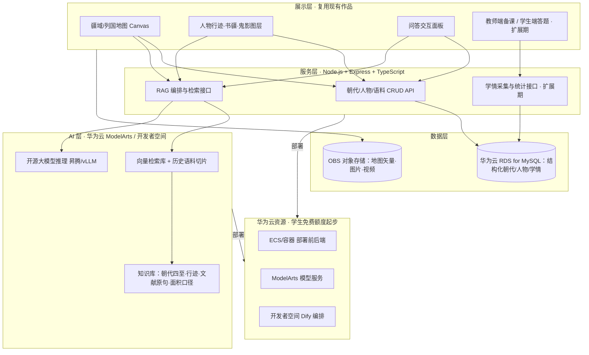

# 《舆图山河录》→ 华为 ICT 大赛创新赛升级方案

> 目标赛事：华为 ICT 大赛 2026—2027 赛季（第十一届）· 创新赛（高教组 · 建议赛题1，映射见第二节末）
> 基线作品：已投递数媒竞赛并进入省赛的单文件交互历史地图
> 编制日期：2026-10-29　｜　组队规模：2–3 人 + 1 名指导教师

---

## 一、结论先行

1. **现有版本不能直接投创新赛**：创新赛评审为「创新性 / 系统复杂性 / 技术复合性 / 社会效益 / 功能完备性」五维，且 **AI 为必选**，要求完整 ICT 技术架构与落地场景；现作品是纯前端静态可视化，缺后端、数据库、AI 与数据流，在②③两项会明显失分。
2. **不重做、而是加层**：现有地图前端、矢量数据、人物库、文献语料、双语与导出能力全部复用为「展示层 + 知识库语料」，向上新增「AI 问答层 + 服务数据层 + 云部署层」。
3. **节奏：MVP 先冲初赛，晋级后再扩课堂系统**。报名 11/30 截止、初赛 12 月，先用「地图 + 知识增强问答」最小可用产品过初筛；2027 年 1–2 月补教师端、学情大数据，备战 3 月中国总决赛。
4. **双轨复用**：同一套数据与前端，产出两份申报叙事——数媒省赛版讲「创意与文化表达」，ICT 版讲「用 ICT 解决历史教学问题」。

---

## 二、赛制与时间线（以本校华为 ICT 学院通知为准，全国框架如下）

| 节点 | 时间（2026—2027 赛季） | 团队动作 |
|---|---|---|
| 报名 | 2026-08-31 ～ **11-30** | 组队、确认指导教师、官网报名（每人仅可报一个赛道） |
| 初赛 | **2026-12** | 提交可运行作品 + 说明材料 / 线上初评答辩 |
| 中国总决赛 | **2027-03** | 15 分钟展示 + 5 分钟问答（PPT / 视频 / 实物） |
| 全球总决赛 | 2027-06（晋级才有） | 英文材料准备 |

> 规则要点：团队 **3 名学生 + 1 名指导教师**（须同校）；报名时**三选一选定赛题且不可更改**；**未采用该赛题要求的华为技术即无参赛资格**；禁止把其他赛事作品不加改进直接参赛（本项目须有 AI/云等实质技术增量）；提交代码须可复现答辩效果；答辩可用中文、英文额外加分。
> 来源：华为 ICT 大赛官网、大连理工/西安交大/绵阳城市学院 2026—2027 报名通知。

### 2.1 第十一届创新赛三道赛题（中国大陆，报名三选一）

| 赛题 | 官方要求 | 技术平台本质 | 晋级通道 |
|---|---|---|---|
| **赛题1** | 基于**华为云产品**打造 AI 创新应用 | 用华为云 ECS/OBS/ModelArts/盘古/RDS 等自研完整 AI 应用，前后端+云架构自由度高 | 初赛→国赛→**全球总决赛** |
| **赛题2** | 基于华为云 **AgentArts（智果）** 平台的 Agent 设计和应用 | 平台内搭智能体：知识库 RAG、工作流、MCP/插件、预置模型、观测评估；自研代码量较少 | 初赛→国赛→全球总决赛 |
| **赛题3** | 基于华为 **ModelEngine Nexent** 打造可进化决策智能体 | 零代码 NL2Agent、ReAct、技能/提示词/记忆自动优化；偏**决策类**智能体 | **仅初赛+国赛，不进全球总决赛** |

### 2.2 前期 A/B/C 三条路径与赛题的对应关系

| 前期路径 | 内容 | 首选赛题 | 可兼用 | 说明 |
|---|---|---|---|---|
| **路径A** AI 历史疆域问答体（RAG 问答） | 地图前端 + 知识库问答 | **赛题2**（AgentArts 知识库 Agent 最直接） | 赛题1（自研 RAG 后端） | 开发最快；若走赛题1，A 作为其 AI 模块 |
| **路径B** 智慧历史地理课堂云系统（教师端+学生端+学情+AI） | 完整云应用、数据闭环 | **赛题1（推荐主选）** | 问答模块可调 AgentArts/ModelArts | 前后端+数据库+云+AI 复合架构最完整，五维覆盖最好 |
| **路径C** 历史政权知识图谱（NLP 抽取+图库+推理） | 数据工程 + 图数据库 + 前端 | **赛题1**（华为云数据库/大数据 + AI 应用） | 赛题2（Agent 自动查图谱） | 场景偏学术，工期长；不属赛题3 决策类 |
| 三条路径共同前提 | 必须落地到某道赛题指定的华为平台，否则无资格 | — | — | 不能停留在纯离线 HTML 形态报名 |

**选型建议：主选赛题1、以路径B为目标、路径A为先期MVP。**
理由：①赛题1 自由度与技术复合性最强，能把"自研前端+后端+数据库+云部署+AI"完整讲清，对应创新赛②③⑤三项；②可晋级全球总决赛；③路径A 的 RAG 问答在赛题1 内先跑通，再长出血统/课堂端，演进不断裂。若团队想大幅降低后端工作量、只求稳妥过初赛，可退选赛题2（把路径A 做成 AgentArts 教学智能体）；赛题3 与本项目"知识问答/教学"场景不匹配且不进全球总决赛，不建议。

---

## 三、现状对评审五维的差距与补齐方式

| 评审维度 | 现有水平 | 主要缺口 | 本方案补齐手段 |
|---|---|---|---|
| ①作品创新性 | 强：三重疆域（管到/写到/走到）概念、不确定性可视化 | 技术创新落点不明显 | 「知识增强大模型 + 历史疆域时空知识库」作为技术创新点，三重疆域作为特色可视化理论 |
| ②系统复杂性 | 弱：单 HTML、无服务端 | 无前后端分离、无数据流转 | 服务端 + 数据库 + AI 服务三层解耦，形成请求—检索—生成—可视化数据流 |
| ③技术复合性 | 弱：原生 JS/Canvas，**无 AI** | AI 必选缺失；缺云/数据库组件 | AI（RAG 大模型）+ 华为云 + 数据库（RDS for MySQL）+ 可选学情大数据，≥3 类 ICT 技术 |
| ④社会效益 | 中强：历史教育、离线普惠 | 无明确用户与落地闭环 | 锁定中学历史课堂 / 通识研学场景，做教师—学生双端与学情反馈闭环 |
| ⑤功能完备性 | 中强：22 切片、90 人、导出、双语 | 无服务端功能、无内容管理 | 保留全部前端功能，新增问答、备课导出、答题记录 |

---

## 四、推荐路线：MVP（RAG 问答体）→ 扩展（智慧课堂云系统）

### 4.1 为什么选「先 RAG、再课堂」

- **起步快**：RAG 不训练大模型，现有历史资料直接向量化检索 + 生成回答，1 个月内可跑通，满足初赛对 AI 的硬性要求。
- **风险低**：Dify / 华为开发者空间 + 开源模型（DeepSeek / GLM 等免费额度）可快速编排，不自研模型。
- **可生长**：问答体是课堂系统的 AI 内核；教师端、学生端、学情统计在晋级后叠加，不推翻重做。
- **复用度高**：现有地图即问答的「可视化界面」——用户提问后 AI 在图上定位朝代、边界、人物行迹并高亮，问答与地图双向联动，区别于普通聊天框。

### 4.2 系统分层架构

> **技术栈落地说明（2026-11 更新，已按赛题 1 对齐）**：服务端由原设想的 Java Spring Boot 改为 **Node.js + Express + TypeScript**（与前端同语言、单仓维护、启动成本低）；数据库由 openGauss 改为 **华为云 RDS for MySQL 8.0**；缓存为 **华为云 DCS for Redis**（客户端固定 RESP2）；对象存储 **OBS**；模型服务为 **ModelArts Studio / 盘古 MaaS**（对话 `openPangu-2.0-Flash`、向量 `BGE-M3`）；研发留痕由 **CodeArts** 承载。上述选型全部落在华为云产品上，满足赛题 1「基于华为云产品打造 AI 创新应用」的技术使用要求；后续新增依赖同样优先选华为云服务。

### 4.3 三层 AI/ICT 技术落点（直接对应「技术复合性」打分）

| 技术组件 | 选型建议（学生低成本起步） | 作用 | 华为栈加分点 |
|---|---|---|---|
| AI 大模型 | 开源模型，经华为 ModelArts / 开发者空间部署（免费额度）；编排可用 Dify | 历史疆域问答、讲解生成、出题 | ModelArts 推理、昇腾 vLLM |
| 知识检索 RAG | 向量库 + 历史语料切片（现有 conf/note/书疆原句/人物行迹说明） | 让回答「有据可查、可溯源到地图点位」，呼应作品严谨性 | 知识工程实践 |
| 数据库 | 华为云 RDS for MySQL 8.0（结构化：朝代、时点、四至、人物、学情记录） | 数据持久化与查询，替代纯前端内联 | 华为云 RDS 数据库服务 |
| 云部署 | 华为云 ECS / 容器 + OBS 存静态资源；同时保留离线包 | 云端可访问演示；弱网现场用离线包兜底 | 华为云全栈 |
| 大数据（扩展期可选） | 学情答题记录聚合统计（学生已学过 Spark，可作亮点但非必需） | 学生掌握度反馈、薄弱朝代推荐 | 大数据技术复合 |
| 端侧（可选亮点） | 鸿蒙手机/平板适配浏览地图与问答 | 全场景协同，呼应鸿蒙生态 | HarmonyOS 适配 |

---

## 五、分阶段排期（倒排对齐赛季）

### 阶段 0｜本周（10/29–11/04）：组队与底座
- [ ] 确定 2–3 人名单、联系 1 名指导教师（优先计算机 / 历史 / 教育技术方向）
- [ ] 华为云注册 + 实名认证 + 开通 ModelArts / 开发者空间免费额度，确认免费 token/代金券
- [ ] 把现有数据导出为结构化语料表：朝代、时点、四至、代表人物、行迹站点、书疆原句、面积口径
- [ ] 仓库拆出「共享数据层」，前端与数媒版解耦

### 阶段 1｜MVP（11/05–11/30）：地图 + RAG 问答，赶报名与初赛
- [ ] 服务端骨架（Node.js + Express + TypeScript）：朝代/人物/语料接口
- [ ] RAG 最小闭环：语料切片入库 → 提问 → 检索 → 大模型生成 → 答案附「地图定位」并高亮对应时点/行迹
- [ ] 现有页面新增问答面板；提问可联动地图切换朝代与取景
- [ ] RDS for MySQL 建库存结构化数据；华为云部署可访问地址 + 保留离线演示包
- [ ] 产出初赛材料：3 分钟演示视频初稿、作品说明、系统截图、架构说明
- [ ] **11/30 前完成官网报名与初赛材料提交**

### 阶段 2｜初赛迭代（2026-12）
- [ ] 根据初评意见补问答效果评估（准确率、引用命中率、答非所问样本表）
- [ ] 完善模型选型说明与合规（模型来源、授权、训练/推理成本）
- [ ] 录制正式演示视频（痛点 → 操作 → AI 问答 → 云架构一页讲清）

### 阶段 3｜晋级扩展（2027-01–02）：从问答体升级为课堂系统
- [ ] 教师端：按朝代一键导出讲解图集（复用现有导出 PNG）、备课讲解词 AI 生成
- [ ] 学生端：分朝代答题 + 作答记录入库；学情统计看板（薄弱朝代/知识点）
- [ ] 补充社会效益与落地分析：目标用户、使用场景、试点课堂计划、可推广性
- [ ] 技术报告与商业（社会价值）说明书定稿

### 阶段 4｜总决赛（2027-03）
- [ ] 15 分钟答辩 PPT + 演示脚本（痛点—架构—演示—价值—创新）
- [ ] 中英文材料准备（英文答辩加分）；现场弱网兜底离线版

---

## 六、2–3 人分工建议

| 角色 | 主要职责 | 建议人选技能 |
|---|---|---|
| 成员 A · 前端/地图 | 复用改造 Canvas 前端、问答面板联动、教师端/学生端界面、演示视频录制剪辑 | Vue/TS、Canvas、UI |
| 成员 B · 后端/云/数据 | Node.js + Express 服务、RDS for MySQL、DCS for Redis、RAG 接口、华为云部署与运维、学情统计 | Node/TS、数据库、云 |
| 成员 C · AI/内容/文档 | 历史语料结构化与切片、RAG 调优与效果评估、题库、技术报告与商业价值文档、PPT | Python/数据处理、写作 |
| 仅 2 人时 | C 的 AI 部分并入 B，文档视频由 A 兼任，先保 MVP 功能闭环 | — |

> 指导教师：把关选题立意、审阅报告；不承担编码。

---

## 七、申报叙事：从「讲历史」转「用 ICT 解决问题」

| 场景 | 核心一句话 | 侧重 |
|---|---|---|
| 数媒省赛版（已有） | 历史地图给一条边界，本作品画出管到的、写到的、走到的三层并看其错位 | 创意、文化表达、可视化设计 |
| **ICT 创新赛版（新）** | 针对中学历史「疆域概念抽象、口径易混、缺交互教具」的痛点，构建知识增强大模型驱动的交互式疆域教学平台，地图可视化 + AI 问答 + 学情反馈一体 | 真实需求、技术架构、AI 应用、教学落地价值 |

**答辩三段式**（沿用原作品「三重疆域」记忆点，但落点换成技术与价值）：
1. 问题：学生看到「唐疆域 1237 万 vs 可核验 944 万」两个数却不懂差别，传统静态地图讲不清口径。
2. 方案：云端平台把疆域矢量、人物行迹、文献语料做成知识库，RAG 大模型结合地图点位作答，教师可备课、学生可练习并回流学情。
3. 特色与价值：三重疆域可视化理论 + 不确定性显式标注 + 离线/云端双形态，服务历史通识教育，社会价值清晰。

---

## 八、申报材料清单（创新赛）

- [ ] 可运行系统（云端地址 + 离线演示包，双保险）
- [ ] 演示视频（建议 3 分钟内：痛点、系统操作、AI 问答联动、架构、价值）
- [ ] 作品技术报告（架构图、技术选型、关键算法/流程、效果评估、创新点）
- [ ] 社会价值 / 落地分析（目标用户、场景、推广路径；如涉及商业化写清潜在模式，不强求盈利）
- [ ] 答辩 PPT（15 分钟版 + 5 分钟问答预案）
- [ ] 数据与模型合规清单：地图数据授权（沿用 Cliopatria CC BY 4.0、Natural Earth PD、天地图审图号）、开源模型来源与许可证、华为云服务说明、AI 工具使用声明
- [ ] 团队与指导教师信息

---

## 九、双轨复用策略（不浪费数媒成果）

| 资产 | 数媒版用法 | ICT 版用法 |
|---|---|---|
| 矢量边界 / 人物库 / 行迹 / 书疆语料 | 直接图形展示 | 转为 RAG 知识库与 RDS for MySQL 结构化数据 |
| Canvas 渲染引擎与图层开关 | 作品本体 | 复用为展示层前端 |
| 三重疆域概念、8 条偏差披露 | 创意主旨 | 知识严谨性与可信度设计依据（数据治理亮点） |
| 中英双语、导出 PNG | 功能 | 扩展为备课导出与多语演示 |
| 申报叙事 | 创意版材料 | 另写技术/价值版，两套文本、一套数据 |

> 注意：两个比赛材料不要直接照搬，评委看重的维度不同；数据与代码共享，叙事与文档分轨产出。

---

## 十、风险与对策

| 风险 | 影响 | 对策 |
|---|---|---|
| 12 月初赛时间紧 | 功能做不完整 | MVP 只保「地图 + RAG 问答 + 云端可访问」，双端与大数据进晋级后 |
| 自训模型成本高、效果不稳 | 技术方案不落地 | 不自训，用开源模型 + RAG；讲清检索增强而非堆参数 |
| 纯前端被质疑技术含量 | ③失分 | 必须出现服务端、数据库、AI 调用、云端部署四类实组件并可演示 |
| 指导教师 / 组队未定 | 错过报名 | 本周内确认；11/30 硬截止前完成注册 |
| 现场网络不稳 | 演示失败 | 云端版 + 离线包双形态切换（离线恰是原作品既有优势） |
| 选题偏大、落地场景空 | ④失分 | 聚焦「中学历史疆域单元教学」单一明确场景，不泛化成「历史文化平台」 |

---

## 十一、本周立即执行清单（下一步可直接开工）

1. 拉齐 2–3 人 + 指导教师名单，完成华为 ICT 大赛官网报名（截止 11/30）。
2. 注册华为云并实名认证，开通 ModelArts / 开发者空间，跑通一个开源模型调用 demo。
3. 将现有 `window.HIGHRES`、人物行迹、书疆原句、面积口径导出为结构化语料 JSON/表。
4. 用 Dify 搭一个最小 RAG：输入「为什么唐 661 和 669 疆域数字不一样」能基于语料作答并附出处。
5. 确定 ICT 版产品名称（建议保留「舆图山河录」品牌 + 副标题「知识增强的历史疆域教学平台」）。

> 待团队确认后，可直接进入：语料结构化脚本、RAG demo 搭建、服务端骨架搭建三项之一。
